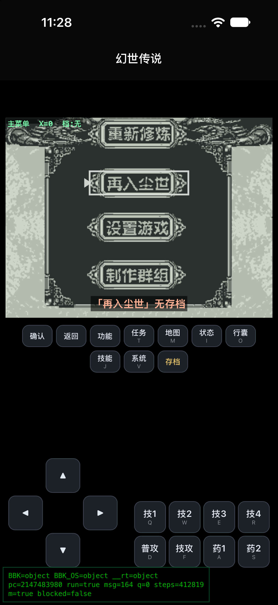

# 步步高 9188《幻世传说》逆向 —— iOS 版

> 一个能把步步高外语通 9188/9288 学习机上的老游戏 **《幻世传说》(hss.exe)**，
> 直接在 iPhone / iPad 上跑起来的逆向 + 移植项目。
> 核心是一个**纯 JavaScript 的大端 MIPS 解释器 + “飞天 OS” API 模拟层**，运行在 `WKWebView` 里。



---

## 一、为什么要做这件事

《幻世传说》是当年步步高 9188/9288“外语通”学习机里的一款 RPG。它的 `hss.exe`：

- 是跑在厂商自研 **MIPS SoC（大端）** 上的 **ECOFF** 可执行文件；
- 依赖一套**闭源的“飞天 OS”固件 API**（图形、输入、声音、文件……）；
- 没有 PC 版、没有源码、市面上也没有能跑它的模拟器。

也就是说，想在今日的 iPhone 上玩它，只能**从零把它的运行环境“重建”出来**。这个项目做的就是这件事。

---

## 二、从 exe 到这个版本，我是一步一步怎么走过来的

### 1. 先把二进制“读懂”
- 解析 ECOFF 头 / 各段(text、data、bss) / 符号表；
- 处理 MIPS 重定位（`parseEcoffRelocs`）；
- 踩过的第一个大坑：**COMMON 符号**要预留足够大的内存槽（最后用了 512KB 大槽），否则多个符号互相踩踏，一运行就黑屏。

### 2. 写一个 MIPS 解释器 —— `mips.js`
- 大端字节序、寄存器堆、内存模型、指令解码执行；
- 系统调用通过一个 **API 分派槽 `onApi`** 跳出到 JS 侧的“操作系统”。

### 3. 造一个“飞天 OS”替身 —— `os.js`
把游戏真正会调用的那些固件 API，逐个用 JS + Canvas + 内存模型实现出来，例如：
`CreateCDD`（建离屏表面）、`ClearDDLcd / FillDDLcd / ReverseDDLcd`（清屏/填充/反显）、
`ScrDDBltDesDD`（把离屏缓冲 present 到屏幕）、`DrawText / PrintString`（画字）、
`GetMessage / DetectKeyState`（消息与按键）……
并测绘出它的 **API 分派表 / 服务号**，让游戏的每一次系统调用都能对上号。

### 4. 逆向渲染管线（最难、也最关键）
- 游戏并不是直接画到屏幕，而是先画到一块**后缓冲 / 离屏表面**（内存地址约 `0x220000`），
  再通过 `ScrDDBltDesDD` 把整块缓冲 **present 到 LCD framebuffer**（`0xfe00000`）；
- 屏幕是 160×240 / 200×160 一类的低分辨率、还带**极性(黑白反转)**约定，需要逐帧校准；
- 文字是**蓝色**的（`RGB(0,120,237)`），`PrintString` 需要**手动把字模 blit 到 framebuffer**，否则要么不显示、要么和背景糊在一起。

### 5. 打通输入与场景
- `GetMessage` 做双通道（事件队列 + 轮询），`DetectKeyState` 供游戏高频查询方向键；
- 依次跑通：**主菜单 → 角色创建（输入名字）→ 可行走的大地图世界**。

### 6. 修掉“点再入尘世就卡死”
表面看像崩溃，真因是**读存档时 `fread` 进了死循环**（新机器上没有存档）。
做了“无存档”的兜底处理后恢复正常。

### 7. 塞进 iOS
- 用 `WKWebView` + **自定义 scheme `bbk-local://`** 同源加载 `index.html`，
  这样 `<script src>` 和 `fetch('hss.exe')`、`fetch('font.bin')` 都能拿到带正确 `Content-Type` 的响应；
- 横竖屏适配、方向回正；
- 所有**虚拟按键（方向 / 确认 / 返回 / 技能 / 物品…）都由 HTML 提供**，不依赖原生控件。

### 8. 从“宿主 App 里的一个入口”到“独立 App”
一开始它是嵌在另一个 App（伏魔记）里、点 **M 按钮**才进入的模拟器界面；
后来把整套引擎**抽成了一个独立的 iOS 工程**（就是本仓库），打开即玩。

### 9. 独立工程踩到的最后一个坑
用较新的 iOS SDK 编译时，App **必须采用 `UIScene` 生命周期**，否则一启动就 `SIGTRAP` 崩溃
（表现是“Build succeeded，但 App 秒退”）。补上 `SceneDelegate` + `Info.plist` 里的
`UIApplicationSceneManifest` 后解决。

---

## 三、目录结构

```
幻世传说/
├── 幻世传说.xcodeproj              # iOS 工程（无第三方依赖，纯 UIKit + WebKit）
└── 幻世传说/
    ├── AppDelegate.swift           # App 入口（UIScene 生命周期）
    ├── SceneDelegate.swift         # 场景宿主，启动即显示模拟器
    ├── HDBBKEmulatorViewController.swift  # WKWebView 宿主 + bbk-local:// scheme 处理
    ├── Info.plist
    └── bbk-emulator/               # ★ 引擎核心（纯 Web，跨平台）
        ├── index.html              # 页面 + 全部虚拟按键 UI
        ├── mips.js                 # 大端 MIPS 解释器
        ├── os.js                   # “飞天 OS” API 模拟层
        ├── realtime.js             # 实时驱动 / 渲染 harness / 场景 pump
        ├── hss.exe                 # 步步高原版游戏二进制（大端 MIPS ECOFF）
        ├── font.bin                # 点阵字库
        └── hss_reloc_resolved.json # 预解析的重定位信息
```

## 四、在 iOS 上跑起来

1. 用 Xcode 打开 `幻世传说/幻世传说.xcodeproj`；
2. 顶部运行目标选一个**具体设备或模拟器**（不要选 “Any iOS Device”，那个只编译不安装）；
3. 真机首次需在 *Signing & Capabilities* 里选上你的 Team；
4. 点 ▶ Run，启动即进入《幻世传说》主菜单。

---

## 五、想在安卓上玩？（引擎本身是跨平台的）

**好消息**：真正的引擎是 `bbk-emulator/` 这一坨 **纯 Web（JS + Canvas）**，跟 iOS 没有任何关系，
MIPS 解释器也不需要任何 native 代码。所以安卓要跑，本质就是“**找个 WebView 把这套 web 资源装进去**”。

### 方式 A：最快验证（免编译）
把 `bbk-emulator/` 整个目录丢到任意静态服务器（或本机 `python3 -m http.server`），
用安卓手机 Chrome 打开其中的 `index.html` 即可运行。
> 注意：必须**同源**访问（用 http(s) 或 WebView 的 asset 映射），直接用 `file://` 打开会因为
> `fetch('hss.exe')` 被 CORS 拦而失败。

### 方式 B：做一个安卓 WebView 壳（推荐，体验等同 iOS 版）
1. 新建 Android 工程，把 `bbk-emulator/` 放进 `app/src/main/assets/bbk-emulator/`；
2. 用 `WebViewAssetLoader` 把 assets 映射到一个伪域名（等价于 iOS 的 `bbk-local://`），
   保证 `index.html` 里对 `hss.exe / font.bin` 的 `fetch` 走同源、拿到正确 `Content-Type`；
3. 加载 `https://appassets.androidplatform.net/assets/bbk-emulator/index.html`；
4. 页面加载完成后，自动点一下“装载并开始”按钮（iOS 版里是这么做的）：
   ```kotlin
   webView.evaluateJavascript(
       "var b=document.getElementById('run'); if(b && !b.__clicked){b.__clicked=1;b.click();}", null)
   ```
关键 Kotlin 片段（B 方案核心）：
```kotlin
val loader = WebViewAssetLoader.Builder()
    .addPathHandler("/assets/", WebViewAssetLoader.AssetsPathHandler(this))
    .build()
webView.webViewClient = object : WebViewClient() {
    override fun shouldInterceptRequest(view: WebView, req: WebResourceRequest) =
        loader.shouldInterceptRequest(req.url) ?: super.shouldInterceptRequest(view, req)
}
webView.settings.javaScriptEnabled = true
webView.settings.domStorageEnabled = true
webView.loadUrl("https://appassets.androidplatform.net/assets/bbk-emulator/index.html")
```
> 输入 / 方向 / 确认键：`index.html` 里已经自带了全套虚拟按键，安卓上**开箱即用**，无需额外写控制层。

如果你把安卓壳做好了，欢迎 PR 回本仓库，我把它放到 `android/` 目录，方便后来人。

---

## 六、当前能玩到什么 / 还有哪些没做完

**目前实测已经可以正常做到的：**
- 开机进入《幻世传说》**主菜单**（重新修炼 / 再入尘世 / 设置游戏 / 制作群组）；
- 新建角色、输入名字，进入**大地图并正常行走**（方向键实时响应）；
- **各类快捷键均可用**：方向、确认、返回、功能、任务、地图、状态、行囊、技能、系统、存档，
  以及战斗相关的 技1~技4 / 普攻 / 技攻 / 药1 / 药2；
- 横竖屏切换正常；无存档时点“再入尘世”已做兜底，不会卡死。

**还没破解出来 / 可能存在的瑕疵（坦白：精力有限）：**
- 仍有一部分逆向工作没能完成，游戏里某些**画面、剧情分支、战斗 / 交易等细节**，
  可能出现**显示错位、文字叠加、行为不完全正确**之类的瑕疵；
- 音效 / 音乐尚未（或仅部分）还原；
- 对**换皮家族其它 exe**（封魔录 / 战争 等）的通用化支持还不完善；
- 底部那行绿色调试信息（`pc=… run=… steps=…`）是开发期遗留的浮层，正式版可去掉。

> ⚠️ **特别说明：我以前从没玩过《幻世传说》。** 很多“应该是什么样”，是我照着二进制**一点点反推**出来的，
> 并不保证和原作完全一致。**如果你玩过原作、发现哪里不对**——不管是数值、流程、剧情、显示还是操作手感——
> **都非常欢迎在 [Issues](../../issues) 里指出来**，我有空会修；
> 也欢迎**有空的朋友直接认领、提 PR**，或者你自己拿去改。这玩意儿能跑起来已经是意外之喜，
> 剩下的坑，指望我一个人慢慢填确实不太现实，见谅 🙏。

### 版权与免责
- `hss.exe`、`font.bin` 等原始游戏资源的**版权归原厂商（步步高）所有**，
  本仓库仅作**逆向学习与技术存档**用途，请在遵守当地法律、且你合法持有原版设备/游戏的前提下使用；
- 如权利人认为不妥，请联系我删除。

---

*如果这个项目让你重新听到了当年那台学习机的开机声，给个 ⭐ 就是对我最大的鼓励。*
